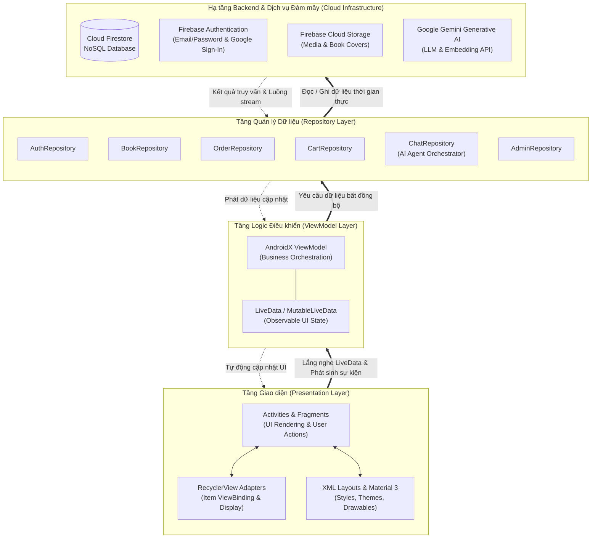
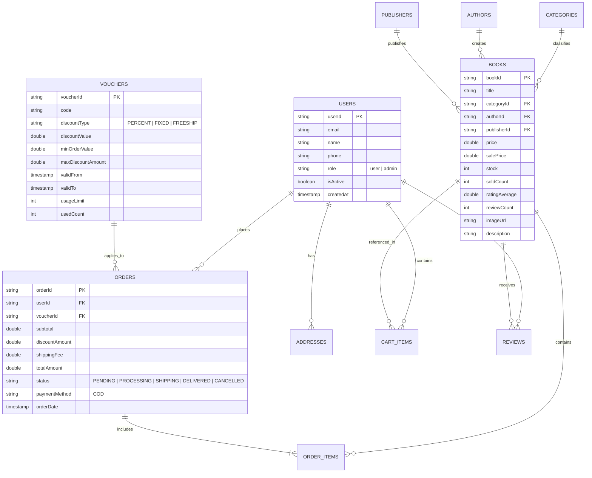
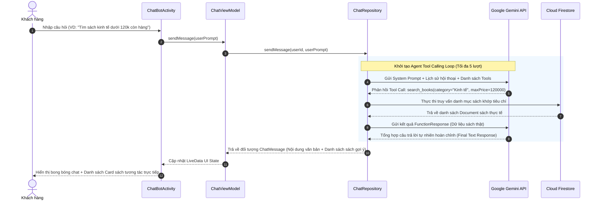
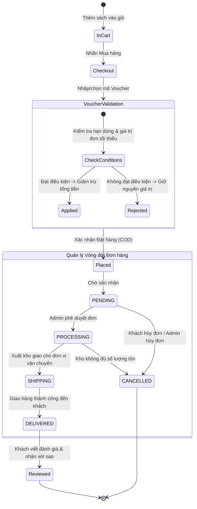
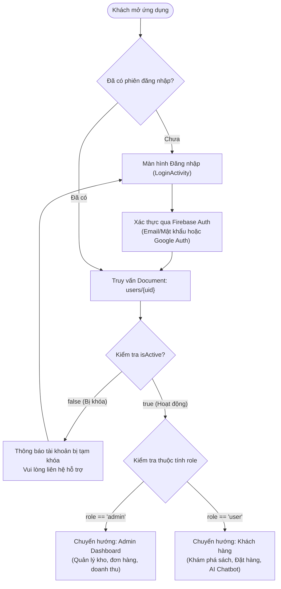

# 📚 ThunderBook - Smart Mobile E-Commerce & Agentic AI Book Store System

<div align="center">


**Hệ thống ứng dụng thương mại điện tử mua bán sách hiện đại trên nền tảng di động Android, tích hợp Trợ lý Trí tuệ Nhân tạo thông minh (Agentic AI - Tool Calling & Semantic Vector Search), vận hành trên kiến trúc MVVM phân tầng và nền tảng dữ liệu thời gian thực Cloud Firestore.**

---

[Tổng quan](#-tổng-quan-hệ-thống) • [Điểm nhấn công nghệ](#-điểm-nhấn-công-nghệ-cốt-lõi) • [Tính năng nghiệp vụ](#-tính-năng-nghiệp-vụ-chi-tiết) • [Kiến trúc hệ thống](#-kiến-trúc-hệ-thống-system-architecture) • [Mô hình dữ liệu](#-mô-hình-dữ-liệu-database-schema) • [Sơ đồ luồng](#-sơ-đồ-luồng-nghiệp-vụ-chính-core-flows) • [Tech Stack](#-tech-stack--thư-viện) • [Cấu trúc thư mục](#-cấu-trúc-mã-nguồn-dự-án) • [Đảm bảo chất lượng (SQA)](#-tiêu-chuẩn-đảm-bảo-chất-lượng-sqa) • [Cài đặt](#-hướng-dẫn-cài-đặt--khởi-chạy)

</div>

---

## 📖 Tổng quan hệ thống

**ThunderBook** là giải pháp phần mềm thương mại điện tử chuyên ngành sách hoàn chỉnh dành cho thiết bị di động Android. Hệ thống được thiết kế nhằm tối ưu hóa hành trình mua sắm của độc giả và tự động hóa quy trình quản lý kinh doanh của nhà sách trực tuyến:

- **Dành cho Độc giả**: Trải nghiệm tìm kiếm thông minh, xem chi tiết sách đa chiều, giỏ hàng linh hoạt, thanh toán hỗ trợ voucher đa tầng, theo dõi trạng thái đơn hàng thời gian thực và đặc biệt là sự hỗ trợ từ **Trợ lý ảo tư vấn sách thông minh (Agentic AI)** có khả năng hiểu ngữ cảnh và tra cứu trực tiếp kho dữ liệu thực tế.
- **Dành cho Quản trị viên (Admin)**: Trung tâm điều hành thông minh với bảng điều khiển phân tích số liệu kinh doanh (Analytics Dashboard), quản lý kho sách, phân loại danh mục/tác giả/nhà xuất bản, điều phối trạng thái đơn hàng, thiết lập mã ưu đãi và giám sát tài khoản người dùng.
- **Tiêu chuẩn Kỹ nghệ phần mềm**: Dự án được triển khai theo mô hình phát triển **V-Model**, tuân thủ nguyên tắc kiến trúc sạch (**Clean MVVM**), đồng thời đáp ứng các tiêu chuẩn chất lượng quốc tế (**IEEE 29148:2018**, **IEEE 730:2014**, **IEEE 828:2012** và **ISO/IEC 25010:2011**).

---

## 🚀 Điểm nhấn công nghệ cốt lõi

### 1. Trợ lý AI thế hệ mới (Agentic AI with Multi-turn Tool Calling)
Khác biệt hoàn toàn với các chatbot sinh văn bản thông thường (dễ bị hiện tượng ảo giác dữ liệu - hallucination), ThunderBook tích hợp trực tiếp **Google Gemini Agent Loop** trên client Android:
- **Tự động kích hoạt công cụ (Function Calling / Tool Calling)**: Khi tiếp nhận yêu cầu từ người dùng, Gemini AI phân tích câu hỏi và tự động phát sinh lệnh gọi các công cụ nghiệp vụ:
  - `search_books`: Lọc sách theo từ khóa, danh mục, tác giả, mức giá và trạng thái khuyến mãi.
  - `check_stock`: Kiểm tra số lượng tồn kho theo thời gian thực từ Cloud Firestore.
  - `get_book_detail`: Lấy toàn bộ thông tin chi tiết của một đầu sách.
- **Tìm kiếm theo ngữ nghĩa (Semantic Vector Search)**: Tích hợp mô hình `gemini-embedding-001` trích xuất đặc trưng văn bản thành vector 3072 chiều. Kết hợp thuật toán tính độ tương đồng góc **Cosine Similarity**, ứng dụng có thể gợi ý chính xác sách dựa trên tâm trạng, sở thích, bối cảnh người đọc mà không cần trùng khớp từ khóa chính xác.
- **Cơ chế In-Memory Vector Cache**: Lưu trữ tạm thời embedding của danh mục sách tại bộ nhớ RAM thiết bị, giúp tốc độ phản hồi đạt mức gần tức thì và giảm thiểu tối đa lưu lượng mạng.

### 2. Động cơ Khuyến mãi đa tầng (Dynamic Voucher Engine)
- Hỗ trợ linh hoạt 3 cơ chế ưu đãi:
  - Giảm giá theo tỷ lệ phần trăm (`%`) kèm giới hạn trần chiết khấu.
  - Giảm trực tiếp theo số tiền cố định (`VNĐ`).
  - Hỗ trợ miễn phí hoặc giảm phí vận chuyển (`Freeship`).
- Kiểm tra hợp lệ đa tầng: Ngày bắt đầu / ngày hết hạn, giá trị đơn hàng tối thiểu, số lượt sử dụng tối đa và số lượt đã dùng thực tế.
- Tự động đồng bộ và tính toán bảng giá thanh toán theo thời gian thực: `Tạm tính + Phí vận chuyển - Khuyến mãi = Tổng tiền`.

### 3. Kiểm soát truy cập & Bảo mật đa tầng (RBAC & Firestore Rules)
- Kiểm soát quyền truy cập dựa trên vai trò (**Role-Based Access Control**): Tách bạch ranh giới chức năng giữa khách hàng (`user`) và ban quản trị (`admin`).
- Tầng phòng ngự Cloud với **Firestore Security Rules**: Ngăn chặn tuyệt đối việc can thiệp dữ liệu trái phép từ client-side, xác thực quyền sở hữu đơn hàng (`isOwner`) và quyền ghi chỉnh sửa tài nguyên hệ thống (`isAdmin`).

### 4. Báo cáo & Trực quan hóa số liệu (Business Analytics)
- Bảng điều khiển quản trị viên (Admin Dashboard) tích hợp thư viện **MPAndroidChart** hiển thị biểu đồ trực quan biến động doanh thu theo thời gian.
- Tổng hợp chỉ số KPI cốt lõi: Doanh số thực, lượng đơn hoàn tất, tỷ lệ hủy đơn, xếp hạng sản phẩm bán chạy nhất và cảnh báo nguy cơ cạn kho.

---

## 🎯 Tính năng nghiệp vụ chi tiết

### 👤 1. Phân hệ Khách hàng (User Experience)
| Nhóm chức năng | Mô tả chi tiết nghiệp vụ |
| :--- | :--- |
| **Xác thực & Tài khoản** | • Đăng ký tài khoản mới với quy chuẩn mật khẩu an toàn.<br>• Đăng nhập bằng Email/Mật khẩu hoặc Đăng nhập nhanh một chạm với **Google Sign-In**.<br>• Cơ chế Quên mật khẩu tự động gửi liên kết khôi phục qua Email.<br>• Cập nhật thông tin cá nhân và thay đổi ảnh đại diện (Avatar). |
| **Khám phá & Bộ lọc** | • Trang chủ sinh động với Banner quảng cáo trượt mượt mà (ViewPager2).<br>• Phân mục rõ ràng: Sách mới phát hành, Sách bán chạy nhất, Sách giảm giá sâu.<br>• Bộ lọc nâng cao đa điều kiện: Lọc theo Thể loại, Tác giả, Nhà xuất bản, Khoảng giá mong muốn.<br>• Sắp xếp linh hoạt theo: Mới nhất, Giá tăng dần, Giá giảm dần, Đánh giá cao nhất.<br>• Tìm kiếm toàn văn (Full-text Search) theo tên sách và tên tác giả. |
| **Thông tin sách đa chiều** | • Hiển thị thông số chi tiết: Bìa sách sắc nét, mô tả nội dung, số trang, kích thước, nhà xuất bản, năm xuất bản.<br>• Hiển thị rõ giá bìa, giá bán ưu đãi và tỷ lệ giảm giá (Sale Tag).<br>• Cập nhật số lượng tồn kho theo thời gian thực.<br>• Xem danh sách đánh giá sao và bình luận từ cộng đồng độc giả đã mua. |
| **Trợ lý AI Độc quyền** | • Khung chat hỗ trợ 24/7 với trí tuệ nhân tạo Gemini.<br>• Tư vấn gợi ý sách phù hợp nhu cầu, tâm trạng, độ tuổi, ngân sách.<br>• Trả lời kèm thẻ sách trực quan cho phép bấm vào để xem chi tiết hoặc thêm vào giỏ hàng ngay lập tức. |
| **Giỏ hàng & Địa chỉ** | • Quản lý giỏ hàng trực quan: Tăng/giảm số lượng sản phẩm, chọn mục cần mua, xóa sản phẩm.<br>• Quản lý danh sách sổ địa chỉ nhận hàng: Thêm mới, chỉnh sửa, xóa và chọn địa chỉ nhận hàng mặc định. |
| **Đặt hàng & Thanh toán** | • Màn hình Checkout rõ ràng: Kiểm tra lại địa chỉ, danh sách sách, phương thức thanh toán COD.<br>• Tích hợp mục chọn Voucher: Hiển thị danh sách mã giảm giá khả dụng, tính toán giảm trừ tự động.<br>• Theo dõi đơn hàng với thanh tiến trình trực quan qua 5 giai đoạn: *Chờ xác nhận $\rightarrow$ Đang xử lý $\rightarrow$ Đang giao $\rightarrow$ Đã giao $\rightarrow$ Đã hủy*. |
| **Đánh giá & Phản hồi** | • Đánh giá sản phẩm theo thang điểm 1 đến 5 sao kèm nhận xét cá nhân (chỉ khả dụng sau khi đơn hàng giao thành công để đảm bảo tính khách quan).<br>• Trang quản lý danh sách các nhận xét cá nhân đã viết. |
| **Hộp thư Thông báo** | • Nhận thông báo tự động khi trạng thái đơn hàng thay đổi.<br>• Nhận thông báo về các chiến dịch khuyến mãi, mã ưu đãi mới từ ban quản trị. |

### 🛠️ 2. Phân hệ Quản trị viên (Admin Management)
| Nhóm chức năng | Mô tả chi tiết nghiệp vụ |
| :--- | :--- |
| **Dashboard Tổng quan** | • Bảng điều khiển KPI: Tổng doanh thu, Số đơn hàng thành công, Tổng đầu sách trong kho, Số lượng người dùng.<br>• Biểu đồ phân tích doanh thu trực quan theo thời gian thực (MPAndroidChart).<br>• Bảng xếp hạng Top sách bán chạy nhất và danh sách cảnh báo tồn kho sắp hết. |
| **Quản lý Kho sách** | • Toàn trình CRUD sách: Thêm đầu sách mới, cập nhật thông tin, thay đổi giá bán, xóa sách.<br>• Tải ảnh bìa sách lên Cloud Storage.<br>• Quản lý các thuộc tính: Danh mục thể loại, Tác giả, Nhà xuất bản, số trang, tồn kho. |
| **Quản trị Phân loại** | • Quản lý Danh mục thể loại (Categories).<br>• Quản lý thông tin Tác giả (Authors) và Nhà xuất bản (Publishers). |
| **Điều phối Đơn hàng** | • Phân loại danh sách đơn hàng theo trạng thái xử lý.<br>• Xem chi tiết danh sách sản phẩm, địa chỉ giao nhận và tổng tiền từng đơn hàng.<br>• Chuyển trạng thái đơn hàng: Tiếp nhận $\rightarrow$ Đóng gói $\rightarrow$ Bàn giao vận chuyển $\rightarrow$ Hoàn tất / Hủy đơn. |
| **Quản lý Khuyến mãi** | • Tạo mã Voucher mới: Tùy chỉnh loại mã (Phần trăm / Số tiền cố định / Freeship).<br>• Thiết lập thời hạn hiệu lực, giá trị đơn hàng tối thiểu và số lượt phát hành. |
| **Quản trị Người dùng** | • Xem danh bạ tài khoản người dùng đăng ký trên hệ thống.<br>• Khóa / Mở khóa tài khoản (Active / Inactive) khi phát hiện dấu hiệu vi phạm.<br>• Xem lịch sử mua sắm của từng khách hàng. |
| **Gửi Thông báo Hệ thống** | • Soạn thảo và phát hành thông báo tin tức / ưu đãi đến toàn bộ người dùng trong ứng dụng. |

---

## 🏛️ Kiến trúc hệ thống (System Architecture)

Ứng dụng tuân thủ nghiêm ngặt nguyên tắc kiến trúc phần mềm sạch **Clean MVVM (Model - View - ViewModel)** kết hợp với **Repository Pattern**:



---

## 🗄️ Mô hình dữ liệu (Database Schema)

Hệ thống lưu trữ trên **Google Cloud Firestore** (NoSQL Database). Dưới đây là lược đồ quan hệ logic giữa các bộ sưu tập (Collections):



---

## 🔄 Sơ đồ luồng nghiệp vụ chính (Core Flows)

### 1. Luồng Trợ lý AI - Vòng lặp Agentic Multi-turn Tool Calling
Luồng hoạt động của Chatbot AI từ thời điểm người dùng nhập yêu cầu tư vấn đến khi hệ thống tự động gọi tool và trả về danh sách sách gợi ý:



---

### 2. Luồng Đặt hàng & Máy trạng thái Đơn hàng (Order State Machine)
Mô hình hóa vòng đời toàn vẹn của một đơn hàng trong hệ thống:



---

### 3. Luồng Kiểm soát Phân quyền (RBAC & Navigation Flow)
Quy trình xác thực danh tính và điều hướng người dùng dựa theo phân quyền quản trị:



---

## 💻 Tech Stack & Thư viện

| Phân tầng / Chức năng | Công nghệ sử dụng | Mục đích kỹ thuật |
| :--- | :--- | :--- |
| **Nền tảng di động** | Android Native (Min SDK 24, Target SDK 36) | Tối ưu hóa hiệu năng phần cứng và độ mượt mà giao diện. |
| **Ngôn ngữ lập trình** | Java 11 | Ngôn ngữ phát triển nền tảng của hệ thống. |
| **Mô hình kiến trúc** | Clean MVVM + Repository Pattern | Chuẩn kiến trúc phân tách độc lập giữa UI, ViewModel và Data. |
| **Trí tuệ nhân tạo (AI)** | Google Gemini API (`v1beta`) | Agentic AI Chatbot, Multi-turn Tool Calling. |
| **Vector Search Engine** | `gemini-embedding-001` | Trích xuất Vector Embedding 3072 chiều & Thuật toán Cosine Similarity. |
| **Cơ sở dữ liệu Đám mây**| Google Cloud Firestore | NoSQL Realtime Database, tối ưu hóa truy vấn di động. |
| **Xác thực người dùng** | Firebase Authentication | Bảo mật thông tin tài khoản, tích hợp Google Sign-In SDK. |
| **Lưu trữ tệp tin** | Firebase Cloud Storage | Lưu trữ phân tán hình ảnh bìa sách và ảnh đại diện người dùng. |
| **Xử lý mạng / HTTP** | OkHttp 4.12.0 | Kết nối mạng, xử lý API RESTful và gọi Gemini Generative AI. |
| **Tải và đệm hình ảnh**| Bumptech Glide 4.16.0 | Tối ưu hóa bộ nhớ RAM, caching 2 tầng (Memory & Disk Cache). |
| **Biểu đồ & Thống kê** | MPAndroidChart 3.1.0 | Trực quan hóa doanh thu và phân tích kinh doanh trên Admin Dashboard. |
| **Giao diện người dùng** | Material Design Components 3 | Hệ thống thành phần giao diện chuẩn Google (Card, Dialog, Chip...). |
| **Kiểm thử tự động** | JUnit, Espresso Core | Đảm bảo chất lượng qua Unit Testing và UI Automation Testing. |

---

## 📂 Cấu trúc mã nguồn dự án

Cấu trúc thư mục mã nguồn được phân bổ khoa học theo đúng mô hình kiến trúc Clean MVVM:

```plaintext
BookApp/
├── app/
│   ├── src/
│   │   ├── main/
│   │   │   ├── java/com/example/bookapp/
│   │   │   │   ├── Adapter/                  # Adapters liên kết dữ liệu với RecyclerView
│   │   │   │   │   ├── admin/                # Adapters phân hệ Admin (Book, Order, Dashboard, Stat...)
│   │   │   │   │   └── user/                 # Adapters phân hệ Khách hàng (Book, Cart, Chat, Review...)
│   │   │   │   ├── Model/                    # Định nghĩa cấu trúc Dữ liệu & Thực thể (Entities)
│   │   │   │   │   ├── Book.java             # Thực thể Sách (Thuộc tính, giá bán, tồn kho)
│   │   │   │   │   ├── Order.java            # Thực thể Đơn hàng (Danh sách món, tổng tiền, trạng thái)
│   │   │   │   │   ├── User.java             # Thực thể Người dùng & Phân quyền
│   │   │   │   │   ├── Voucher.java          # Thực thể Mã giảm giá
│   │   │   │   │   ├── ChatMessage.java      # Thực thể Tin nhắn Chatbot & Danh sách gợi ý
│   │   │   │   │   └── ...
│   │   │   │   ├── Repository/               # Tầng trừu tượng hóa giao tiếp Dữ liệu & Cloud
│   │   │   │   │   ├── AuthRepository.java   # Quản lý Đăng nhập, Đăng ký, Google Auth
│   │   │   │   │   ├── BookRepository.java   # Truy vấn danh mục, tìm kiếm, lọc sách
│   │   │   │   │   ├── OrderRepository.java  # Đặt hàng, cập nhật trạng thái đơn
│   │   │   │   │   ├── ChatRepository.java   # Điều phối Agent Loop & Gemini Tool Calling
│   │   │   │   │   └── ...
│   │   │   │   ├── Utils/                    # Các module tiện ích và hằng số toàn cục
│   │   │   │   │   ├── Constants.java        # Hằng số hệ thống, Endpoint, API Keys
│   │   │   │   │   └── FirebaseUtils.java    # Khởi tạo thể hiện Firebase tập trung
│   │   │   │   ├── View/                     # Tầng Giao diện người dùng (Presentation Layer)
│   │   │   │   │   ├── admin/                # Các Activity / Fragment quản trị hệ thống
│   │   │   │   │   └── user/                 # Các Activity / Fragment trải nghiệm khách hàng
│   │   │   │   └── ViewModel/                # Tầng Quản lý Trạng thái UI (Lifecycle-aware)
│   │   │   │       ├── HomeViewModel.java    # State màn hình chính
│   │   │   │       ├── ChatViewModel.java    # State khung chat trợ lý AI
│   │   │   │       ├── CheckoutViewModel.java# State tính toán thanh toán & Voucher
│   │   │   │       ├── AdminDashboardViewModel.java # State thống kê doanh thu
│   │   │   │       └── ...
│   │   │   ├── res/                          # Tài nguyên giao diện (Layouts XML, Vector Drawables, Styles)
│   │   │   └── AndroidManifest.xml           # Khai báo cấu hình ứng dụng, thành phần & quyền hạn
│   ├── build.gradle.kts                      # Cấu hình phụ thuộc và Gradle build script
│   └── proguard-rules.pro                    # Quy tắc bảo vệ và rút gọn mã nguồn
├── firestore.rules                           # Bộ quy tắc bảo mật dữ liệu Cloud Firestore
└── build.gradle.kts                          # Cấu hình Gradle toàn dự án
```

---

## 🛡️ Tiêu chuẩn Đảm bảo Chất lượng (SQA)

Hệ thống được phát triển với tính kỷ luật kỹ nghệ cao, áp dụng các tiêu chuẩn chất lượng công nghiệp nhằm đảm bảo độ tin cậy, an toàn và khả năng mở rộng:

### 1. Khung tiêu chuẩn quốc tế áp dụng
- **IEEE 29148:2018 (Requirements Engineering)**: Chuẩn hóa quy trình đặc tả yêu cầu phần mềm (SRS). Mọi chức năng nghiệp vụ (FR01 - FR06) đều được định nghĩa rõ ràng về tiền điều kiện, luồng xử lý chính, luồng phụ và tiêu chí chấp nhận.
- **IEEE 730:2014 (Software Quality Assurance)**: Thiết lập quy trình đảm bảo chất lượng, thẩm định tài liệu kỹ thuật và rà soát đồng cấp (Peer Review) nghiêm ngặt.
- **IEEE 828:2012 (Configuration Management)**: Quản lý phiên bản mã nguồn theo nguyên tắc **Semantic Versioning (SemVer)** và đóng băng đường cơ sở (Baseline Control) tại các mốc phát hành.
- **ISO/IEC 25010:2011 (Product Quality Model)**: Kiểm soát 8 thuộc tính chất lượng phần mềm: *Tính đầy đủ chức năng, Hiệu năng vận hành, Khả năng tương thích, Tính dễ sử dụng, Độ tin cậy, Tính bảo mật an toàn, Khả năng bảo trì và Tính khả chuyển*.

### 2. Mô hình phát triển V-Model đối xứng
Dự án áp dụng mô hình chữ V nhằm bảo đảm tính xác minh liên tục giữa thiết kế và kiểm thử:

```plaintext
[Đặc tả Yêu cầu Khách hàng]                   <--->  [Kiểm thử Chấp nhận (UAT)]
      \                                                   /
   [Đặc tả Yêu cầu Phần mềm (SRS)]             <--->  [Kiểm thử Hệ thống (System Test)]
         \                                             /
      [Thiết kế Kiến trúc Hệ thống (HLD)]   <--->  [Kiểm thử Tích hợp (Integration Test)]
            \                                       /
         [Thiết kế Chi tiết Thành phần (LLD)] <--->  [Kiểm thử Đơn vị (Unit Test)]
               \                                 /
                   -----> [Viết mã nguồn (Coding)] ---
```

### 3. Ma trận truy vết yêu cầu hai chiều (Bi-directional RTM)
Khả năng truy vết 100% giữa yêu cầu nghiệp vụ, thành phần mã nguồn và cấu trúc lưu trữ:

| Mã FR | Tên yêu cầu chức năng | Thành phần View / UI | Thành phần ViewModel | Collection Firestore |
| :---: | :--- | :--- | :--- | :--- |
| **FR01** | Xác thực & Tài khoản | `LoginActivity`, `RegisterActivity`, `ProfileFragment` | `AuthViewModel`, `AuthRepository` | `users` |
| **FR02** | Khám phá & Tìm kiếm sách | `HomeFragment`, `SearchActivity`, `BookDetailActivity` | `HomeViewModel`, `BookRepository` | `books`, `categories`, `authors` |
| **FR03** | Giỏ hàng & Địa chỉ nhận | `CartFragment`, `AddressListActivity`, `AddEditAddressActivity` | `CartViewModel`, `CartRepository` | `users/{id}/items`, `users/{id}/addresses` |
| **FR04** | Đặt hàng & Động cơ Voucher| `CheckoutActivity`, `SelectVoucherActivity`, `OrderDetailActivity`| `CheckoutViewModel`, `OrderRepository` | `orders`, `vouchers` |
| **FR05** | Đánh giá & Phản hồi | `WriteReviewActivity`, `BookReviewsActivity` | `ReviewViewModel`, `ReviewRepository` | `reviews` |
| **FR06** | Quản trị hệ thống (Admin) | `AdminDashboardActivity`, `ManageBookActivity`, `ManageOrderActivity`| `AdminBookViewModel`, `AdminOrderViewModel` | Toàn bộ Collections |

---

## 🔒 Quy tắc bảo mật dữ liệu Cloud (Firestore Rules)

Mọi yêu cầu đọc/ghi dữ liệu từ thiết bị đều phải vượt qua bộ lọc quy tắc bảo mật được thiết lập tại tệp [firestore.rules](file:///D:/folderrapp/BookApp/firestore.rules):

```javascript
rules_version = '2';
service cloud.firestore {
  match /databases/{database}/documents {
    
    // Kiểm tra tính hợp lệ của phiên xác thực
    function isAuthenticated() {
      return request.auth != null;
    }
    
    // Xác thực quyền Quản trị viên dựa trên dữ liệu người dùng
    function isAdmin() {
      return isAuthenticated() && 
             get(/databases/$(database)/documents/users/$(request.auth.uid)).data.role == 'admin';
    }
    
    // Kiểm tra quyền sở hữu tài nguyên
    function isOwner(userId) {
      return isAuthenticated() && request.auth.uid == userId;
    }

    // Bảo mật hồ sơ người dùng
    match /users/{userId} {
      allow read, write: if isOwner(userId) || isAdmin();
    }
    
    // Dữ liệu kho sách, danh mục, tác giả: Đọc công khai, chỉ Admin được phép ghi/sửa/xóa
    match /books/{document=**} {
      allow read: if true;
      allow write: if isAdmin();
    }
    match /categories/{document=**} {
      allow read: if true;
      allow write: if isAdmin();
    }
    
    // Dữ liệu đơn hàng: Người dùng chỉ xem được đơn của mình, Admin quản lý toàn bộ
    match /orders/{orderId} {
      allow read: if isOwner(resource.data.userId) || isAdmin();
      allow create: if isAuthenticated() && request.resource.data.userId == request.auth.uid;
      allow update: if isAdmin() || isOwner(resource.data.userId);
      allow delete: if isAdmin();
    }
  }
}
```

---

## 🛠️ Hướng dẫn cài đặt & Khởi chạy

### Yêu cầu môi trường
- **Hệ điều hành**: Windows 10/11, macOS hoặc Linux.
- **Android Studio**: Phiên bản Ladybug (2024.2+) hoặc mới hơn.
- **Java Development Kit (JDK)**: Phiên bản 11.
- **Android SDK**: Compile SDK 36, Min SDK 24.
- Thiết bị thử nghiệm: Máy ảo Android (Emulator) hoặc Thiết bị thật có cài đặt Google Play Services.

### Các bước cài đặt chi tiết

1. **Tải mã nguồn về máy**:
   ```bash
   git clone https://github.com/<your-repository>/BookApp.git
   cd BookApp
   ```

2. **Cấu hình dịch vụ Firebase**:
   - Truy cập [Firebase Console](https://console.firebase.google.com/) và tạo một dự án mới.
   - Thêm ứng dụng Android với định danh Package: `com.example.bookapp`.
   - Bật các tính năng:
     - **Firebase Authentication** (kích hoạt Email/Password Provider và Google Provider).
     - **Cloud Firestore Database** (chọn chế độ Production và triển khai tệp `firestore.rules`).
     - **Firebase Cloud Storage** (lưu trữ hình ảnh).
   - Tải tệp cấu hình `google-services.json` về và lưu vào vị trí: `BookApp/app/google-services.json`.

3. **Cấu hình Google Gemini API Key**:
   - Khởi tạo API Key tại cổng phát triển [Google AI Studio](https://aistudio.google.com/).
   - Mở tệp `app/src/main/java/com/example/bookapp/Utils/Constants.java` và gán giá trị khóa:
     ```java
     public static final String GEMINI_API_KEY = "YOUR_GEMINI_API_KEY_HERE";
     ```

4. **Biên dịch và khởi chạy**:
   - Mở dự án trong **Android Studio**.
   - Thực hiện **Gradle Sync** để tự động tải các gói phụ thuộc.
   - Nhấn **Run** (`Shift + F10`) để triển khai và trải nghiệm ứng dụng trên thiết bị.

---

## 📄 Giấy phép mã nguồn (License)

Dự án được phân phối dưới giấy phép **[MIT License](LICENSE)**. Được phép tự do nghiên cứu, tham khảo và phát triển ứng dụng.
